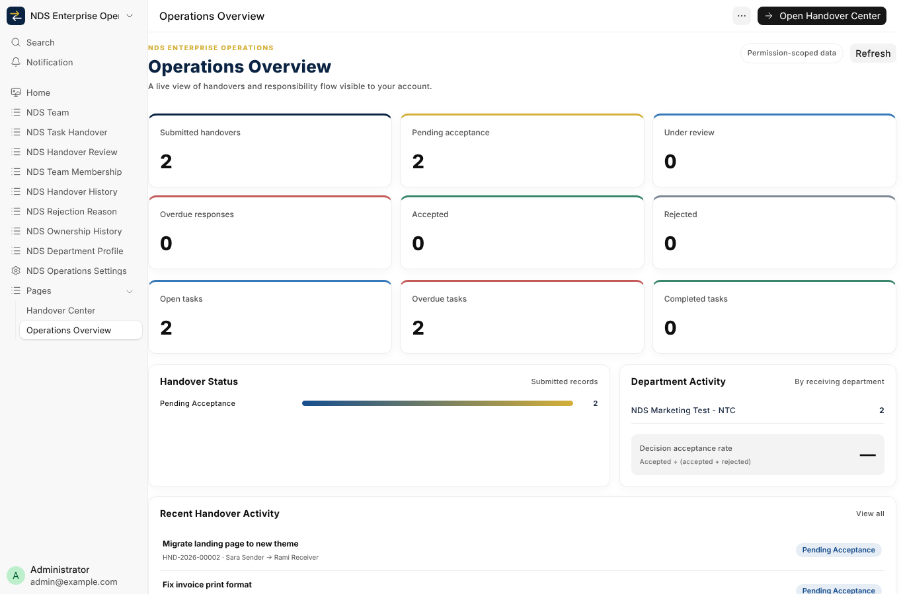
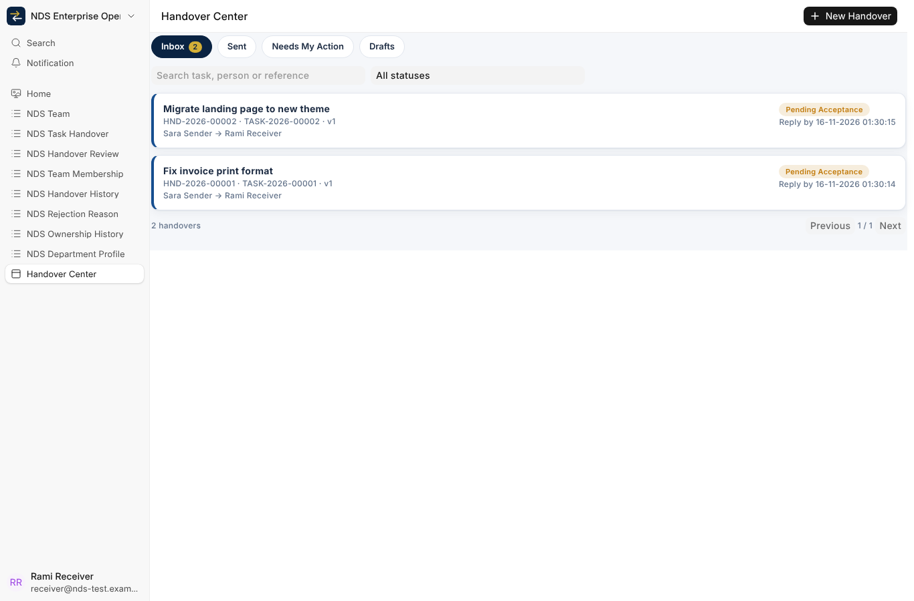
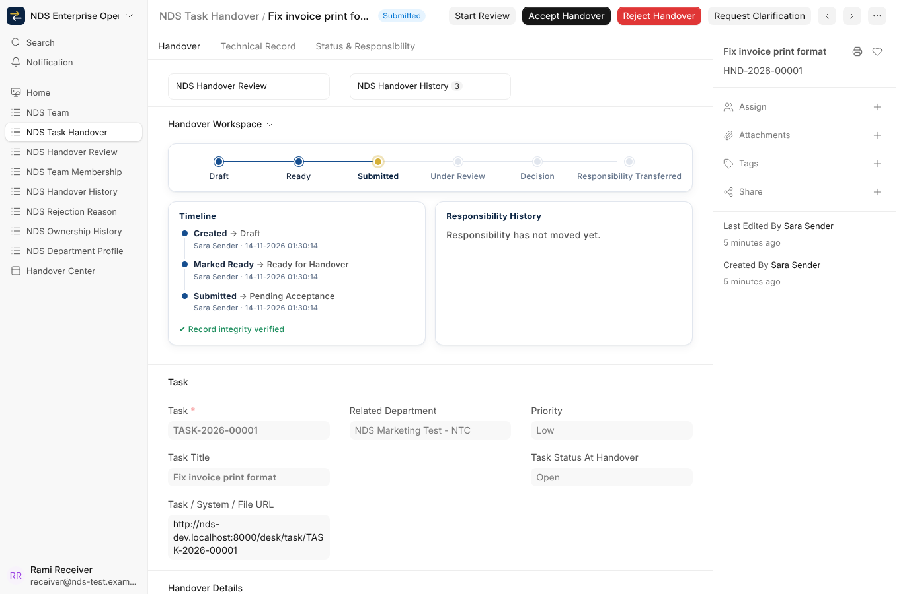
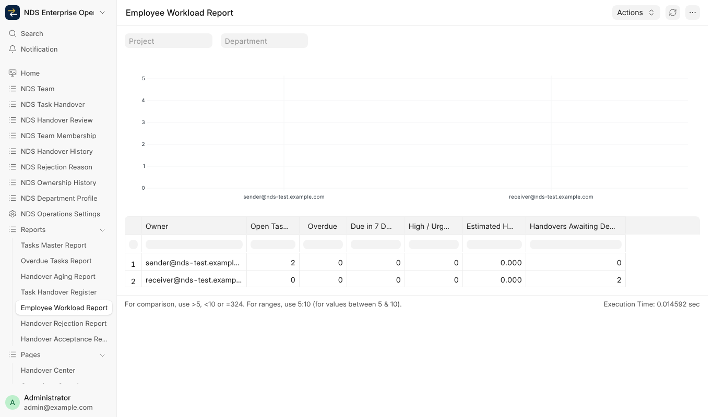
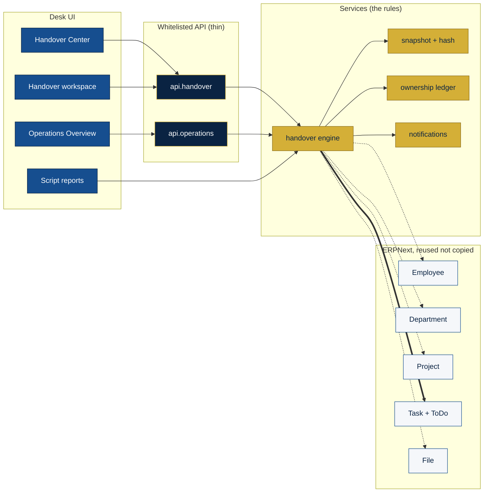

<div align="center">



<br/>

[](https://frappe.io)
[](https://erpnext.com)
[](#-verified-status)
[](#-verified-status)
[](license.txt)

**[Handover](#-the-heart-task-handover--acceptance)** ·
**[Capabilities](#-capabilities)** ·
**[Screens](#-screens)** ·
**[Architecture](#-architecture)** ·
**[Verified status](#-verified-status)** ·
**[Run it](#-run-it-on-an-isolated-bench)** ·
**[العربية](#-بالعربية)**


</div>

## ✦ Not a task list

Most task tools change an owner's name and call it a handover. This app treats a handover as a **formal, documented, auditable transaction** on top of ERPNext:

> A task is never "handed over" because someone clicked a button, and never "received" because it appeared in someone else's list.

The sender submits a **frozen, hashed snapshot**. The receiver reviews it and **accepts, rejects, or asks for clarification**. Responsibility moves **only on acceptance**, in one atomic step written to an **append-only ownership ledger**. If a person leaves or changes department, the next owner can understand everything that happened without asking the previous one.

```text
Company → Department → Team → Employee → Project → Task → Handover → Acceptance → Results
```


## ◆ The heart: Task Handover & Acceptance

<div align="center">

</div>

| Moment | What the system guarantees |
| --- | --- |
| **Submit** | Required fields are checked server-side, one open handover per task, and a SHA-256 snapshot of what the receiver will see is frozen. A retry with the same request id never duplicates. |
| **Review** | Only the named receiver can decide. The sender cannot accept for himself, and nobody can forge the sender identity. |
| **Accept** | Three explicit confirmations (details read, attachments received, responsibilities understood). Ownership, assignment and department move in one transaction, or not at all. |
| **Reject** | A reason and details are mandatory. Ownership does not move. The attempt stays in history. |
| **Clarify** | Questions go back to the sender, nothing is decided, ownership stays. |
| **Revise / re-handover** | A new version is created; earlier versions and snapshots are kept. A task can pass through many owners, in order. |
| **Tamper check** | The stored hash is verified on read, so a database edit of an approved handover is detected. |


## ❖ Capabilities

<table>
<tr>
<td width="33%" valign="top">

### 🏛 Organization
Teams, memberships (one primary team, no overlaps), department profiles with manager and deputy, and rejection reasons — all **data, never hard-coded**. Employee, Department and Company stay the ERPNext originals.

</td>
<td width="33%" valign="top">

### 🔐 Backend permissions
Row scoping through `permission_query_conditions` and `has_permission`, plus controller guards that also bind the Administrator. Team leaders see their teams, department managers their departments, receivers what is addressed to them.

</td>
<td width="33%" valign="top">

### 🧾 Immutable audit trail
Submitted handovers, reviews, history and the ownership ledger cannot be edited or deleted. A unique `(task, sequence)` key makes a double ownership transfer impossible.

</td>
</tr>
<tr>
<td valign="top">

### 📊 Operations Overview
Permission-scoped KPIs for handovers and tasks. Every card opens the matching filtered list. Empty states instead of fake numbers.

</td>
<td valign="top">

### 📑 Reports
Task Handover Register, Acceptance (first-pass rate, hours), Rejection (reasons chart), Aging (buckets), Tasks Master, Overdue Tasks, Employee Workload. Export through the standard report tools.

</td>
<td valign="top">

### 🎨 Brand &amp; UX
Navy, Royal Blue and Gold tokens, dark mode, logical CSS properties for RTL, responsive layouts, a stage bar and a vertical timeline on every handover.

</td>
</tr>
</table>


## ◈ Screens

> Captured from the isolated development bench with sandbox data.

<table>
<tr>
<td width="50%"><a href="docs/screenshots/operations-overview.png"></a><br/><sub><b>Operations Overview</b> — scoped KPIs, status distribution, department activity</sub></td>
<td width="50%"><a href="docs/screenshots/handover-center.png"></a><br/><sub><b>Handover Center</b> — inbox, sent, needs my action, drafts</sub></td>
</tr>
<tr>
<td><a href="docs/screenshots/handover-form.png"></a><br/><sub><b>Handover workspace</b> — stage bar, timeline, responsibility history, actions</sub></td>
<td><a href="docs/screenshots/report-workload.png"></a><br/><sub><b>Employee Workload</b> — open, overdue and awaiting-decision load per owner</sub></td>
</tr>
</table>


## ⬡ Architecture



**Locking order** is always *handover row, then task row*. Ownership is the last ledger row, else the first open ToDo, else the task creator. The rules live in `services/`, so the API and the form cannot disagree.

Full detail — reuse matrix, ER and state diagrams, permission matrix, screen map, risks — is in [`docs/ARCHITECTURE.md`](docs/ARCHITECTURE.md).

<details>
<summary><b>Repository layout</b></summary>

```text
nds_operations/
  hooks.py  install.py  permissions.py  constants.py  reports.py
  nds_enterprise_operations/
    doctype/   # NDS Task Handover, Team, Team Membership, Department Profile, Review, History, Ownership, ...
    page/      # Handover Center, Operations Overview
    report/    # 7 script reports
    workspace/ # workspace, sidebar, desktop icon
  services/    # handover engine, snapshot, ownership, notifications, history
  api/         # whitelisted, permission-checked endpoints
  public/      # brand CSS and desk JS
  tests/       # flow, security, concurrency, dashboard, reports, org scope
docs/          # architecture, deployment and rollback, screenshots, assets
```

</details>


## ✔ Verified status

<div align="center"></div>

<br/>

| Area | Status | Evidence |
| --- | --- | --- |
| Handover engine, snapshot, ledger, idempotency | **PASS** | integration tests on an isolated Frappe 16 bench |
| Concurrency (double accept, accept vs withdraw, two submits) | **PASS** | three tests with real separate database connections |
| Permissions and immutability, including Administrator | **PASS** | security tests, backend-enforced |
| Team leader / department manager scope | **PASS** | org-scope tests |
| Operations Overview and 7 reports | **PASS** | tests plus a real browser check |
| RTL layout, Arabic translations, remaining 7 reports, delegation, org chart, kanban/gantt | **NOT IMPLEMENTED** | tracked in the architecture document |
| Production installation | **BLOCKED** | needs explicit approval, a backup and the rollback plan |


## ▶ Run it on an isolated bench

Use a **disposable** bench and site. Never run this against a production site first.

```bash
bench init --frappe-branch version-16 frappe-bench && cd frappe-bench
bench get-app --branch version-16 erpnext
bench get-app https://github.com/moh222salah/tasks
bench new-site nds-dev.localhost --install-app erpnext
bench --site nds-dev.localhost install-app nds_operations
bench --site nds-dev.localhost set-config allow_tests true      # development sites only
bench --site nds-dev.localhost run-tests --app nds_operations
```

Production steps — a checkpoint, the change, and an immediate rollback — are in [`docs/DEPLOYMENT.md`](docs/DEPLOYMENT.md).

## ⛨ Safety rules

- No edits to ERPNext or Frappe core; the app extends only through hooks, DocTypes and standard APIs.
- No credentials, tokens or site data in this repository.
- No migration, restart, update or deploy on a real site without explicit approval, a backup and a rollback plan.


## ◉ بالعربية

<div dir="rtl">

**إدارة الفرق والأقسام والعمليات المؤسسية** — تطبيق Frappe/ERPNext v16 لشركة NDS.

ليس مدير مهام تقليدي. قلبه **تسليم واستلام المهام**: المرسل يقدّم نسخة مجمّدة وموثّقة بتوقيع رقمي، والمستلم يراجعها ثم **يقبل أو يرفض أو يطلب توضيحًا**. المسؤولية **لا تنتقل إلا بعد القبول**، في خطوة واحدة ذرّية تُسجَّل في سجل مسؤوليات لا يُعدَّل ولا يُحذف. الصلاحيات مطبّقة في الـ backend وليس في الواجهة فقط، ولا يوجد أي تعديل على نواة ERPNext أو Frappe.

الحالة الفعلية: 41 اختبارًا ناجحًا، منها 3 اختبارات تزامن حقيقية. الترجمة العربية الكاملة وفحص RTL **لم يُنفَّذا بعد**.

</div>

<div align="center">


<sub><b>One Organization. Connected Teams. Clear Ownership. Measurable Results.</b></sub>

</div>
