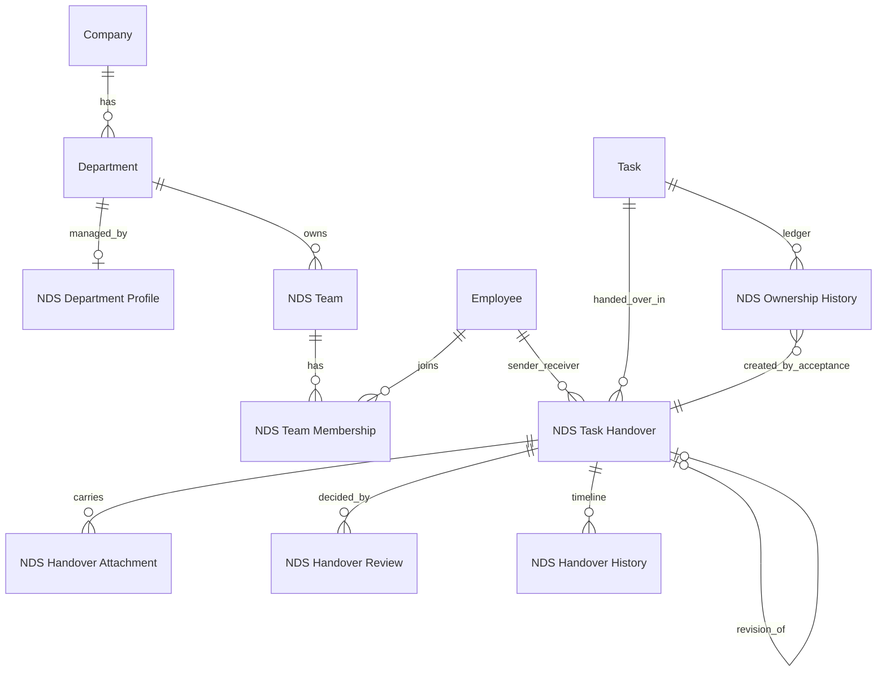
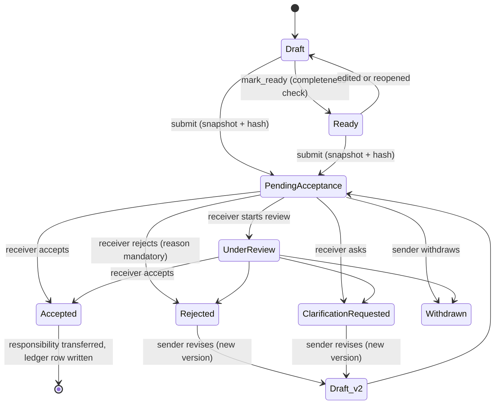

# NDS Enterprise Operations — Architecture

Status legend used across the docs: **PASS** (verified by a real test or a real browser run), **NOT IMPLEMENTED**,
**BLOCKED** (needs something outside this repository). Nothing here was run on a production or Saudi ERP site.

## 1. Baseline

| Item | Finding | Evidence |
| --- | --- | --- |
| Target platform | Frappe 16 / ERPNext 16 (Python 3.14, MariaDB) | built from `version-16` on an isolated bench |
| Saudi production site (`ndserpsa.nds-sa.com`, repo `moh222salah/ndserp-sa`) | **Not inspected, not touched.** Its installed apps, customisations and User Permission set are unknown to this work | BLOCKED until an audit is run there (read-only) |
| Egyptian ERP | Not touched | — |
| ERPNext `Employee` | Creates a **User Permission on Employee for every user** by default, which hides other employees from link fields and lists | observed; handled by `ignore_user_permissions` on the app's Link fields |
| HRMS | Not required. Only Employee, Department, Company, Project, Task, ToDo, File, Notification Log, Role are used | — |

## 2. Reuse matrix

| ERPNext / Frappe | Used for | Duplicated? |
| --- | --- | --- |
| Employee | people, user link, department, designation | no |
| Department (tree) | org structure; `NDS Department Profile` only adds manager / deputy | no |
| Company | via Employee / Department | no |
| Task | the unit of work; ownership mirrored in its **ToDo** assignments; department updated on cross-department acceptance | no (no custom fields added) |
| Project | linked from the handover | no |
| ToDo + `assign_to` | who currently holds a task | no |
| File | attachments; private files follow the handover's permissions | no |
| Notification Log | in-app alerts with a deep link | no |
| Role | 10 new roles; `Employee`, `System Manager` reused | no |

New DocTypes: `NDS Task Handover` (submittable), `NDS Handover Attachment` (child), `NDS Handover Review`,
`NDS Handover History`, `NDS Ownership History`, `NDS Team`, `NDS Team Membership`, `NDS Department Profile`,
`NDS Operations Settings` (single), `NDS Rejection Reason`.

## 3. Module architecture

```
Desk UI (JS/CSS)  ──►  api/handover.py (whitelisted, thin)  ──►  services/handover.py (the engine)
                                                                     ├─ services/ownership.py  (ledger, current owner)
                                                                     ├─ services/snapshot.py   (frozen JSON + SHA-256)
                                                                     ├─ services/history.py    (append-only timeline)
                                                                     └─ services/notifications.py
DocType controllers (validation, identity forcing)  ·  permissions.py (row scope, deny-only hooks)
```

Design rules that carry the safety of the module:

* **A submitted handover is immutable** — no field is `allow_on_submit`; the controller blocks update, cancel and delete.
* **Engine-only state.** `handover_status`, ownership and decision fields are written by the engine; a draft saved from
  the form or REST keeps the database values for them (a forged `handover_status` is ignored — tested).
* **The sender is the session user.** Sender fields are rebuilt from Employee on every draft save.
* **Responsibility moves only on acceptance**, in the same transaction as the decision, after re-validating that the task's
  ownership did not change since submission.
* **Lock order is always handover row → Task row.** A unique `(task, sequence)` key on the ledger is the last line of defence.
* **Idempotent.** Retried requests carry a `request_id` and replay the first result instead of repeating it.

## 4. DocTypes and relationships



## 5. Handover workflow

Execution status (the ERPNext Task) and handover status are separate fields. Draft and Ready are `docstatus 0`;
everything after submission is `docstatus 1` and engine-managed.



## 6. Permission matrix (enforced in the backend)

| Actor | Create / edit draft | Submit | Accept / Reject / Clarify | Withdraw / Revise | Read |
| --- | --- | --- | --- | --- | --- |
| Sender (must own the task, or manage its department) | own drafts | own drafts | — | own handovers | own, drafts included |
| Receiver (named on the handover) | — | — | **only the named receiver** | — | submitted handovers addressed to them |
| Team Leader / Department Manager | — | — | — | — | submitted handovers of their teams / departments |
| Executive Management, Read Only Auditor | — | — | — | — | every submitted handover |
| Operations Manager, System Manager | per DocPerm | per DocPerm | **not on behalf of others** | — | everything |
| Anyone, including Administrator | submitted records cannot be edited, cancelled or deleted; reviews, history and ledger rows are append-only | | | | |

Implementation: DocPerm roles + `permission_query_conditions` (list scoping) + `has_permission` (deny-only) in
`permissions.py` + controller/engine guards, because Administrator bypasses permission hooks.
Delegated acceptance and "approved exceptional self-acceptance" are **NOT IMPLEMENTED** (self-handover is always refused).

## 7. UI / UX screen map

| Screen | State |
| --- | --- |
| Handover Center (inbox, sent, needs my action, drafts, search, pagination, counts) | PASS (browser-verified) |
| Handover form workspace: stage bar, timeline, responsibility history, decisions, versions, integrity flag, action buttons and dialogs | PASS (browser-verified) |
| New Handover dialog | implemented; PASS in browser for Accept dialog only |
| Workspace + sidebar + desktop icon | implemented; sidebar entry order not yet verified |
| Executive dashboard, KPI cards, org chart, reports, kanban/gantt, notification settings, delegation | NOT IMPLEMENTED |
| RTL / mobile layout | CSS uses logical properties; not yet verified in a browser |

## 8. Risk assessment

| Risk | Mitigation / status |
| --- | --- |
| Unknown customisations on the Saudi site (User Permissions, Task client scripts, workflows on Task) | read-only audit **before** any install (BLOCKED) |
| Installing adds tables, roles, a workspace and a page | no Custom Fields and no core edits; uninstall removes them; full backup first (`docs/DEPLOYMENT.md`) |
| `ignore_user_permissions` on Employee/Department/Team links | deliberate: visibility is scoped by this app's own query conditions and tested |
| Manual ToDo re-assignment while a handover is pending | accept is refused if the ledger/ownership no longer matches; automatic ledger rows for manual reassignment **NOT IMPLEMENTED** |
| Notifications use Notification Log (+ the user's email settings) | no custom email; verified rows are created |
| Task.department changes on cross-department acceptance | by design, recorded in the ledger and as a Task comment |

## 9. Implementation plan and status

| Phase | Status |
| --- | --- |
| Org layer (Team, Membership, Department Profile, Settings, Rejection Reasons) | PASS (installed, validated) |
| Handover engine, API, snapshot, ledger, idempotency | PASS (24 tests) |
| Concurrency (3 real multi-connection races) | PASS |
| Desk UI (center, form, dialogs, CSS) | PASS (browser) |
| Dashboard / KPIs / 14 reports | NOT IMPLEMENTED |
| Task Update / Checklist / Review, Department KPI, Team Assignment | NOT IMPLEMENTED |
| Arabic translations (`translations/ar.csv`), local fonts | NOT IMPLEMENTED |
| Production audit and deployment | BLOCKED (needs explicit approval) |
