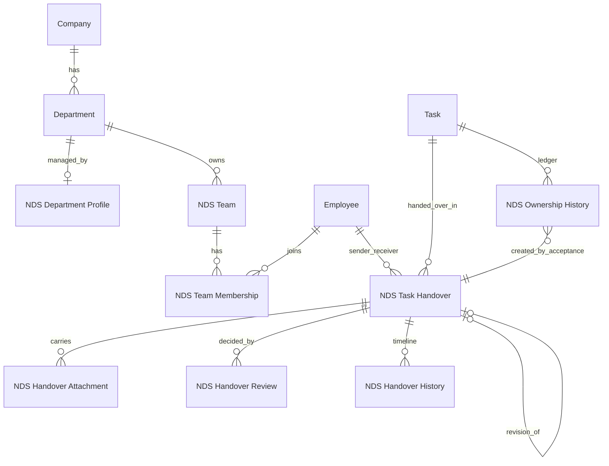
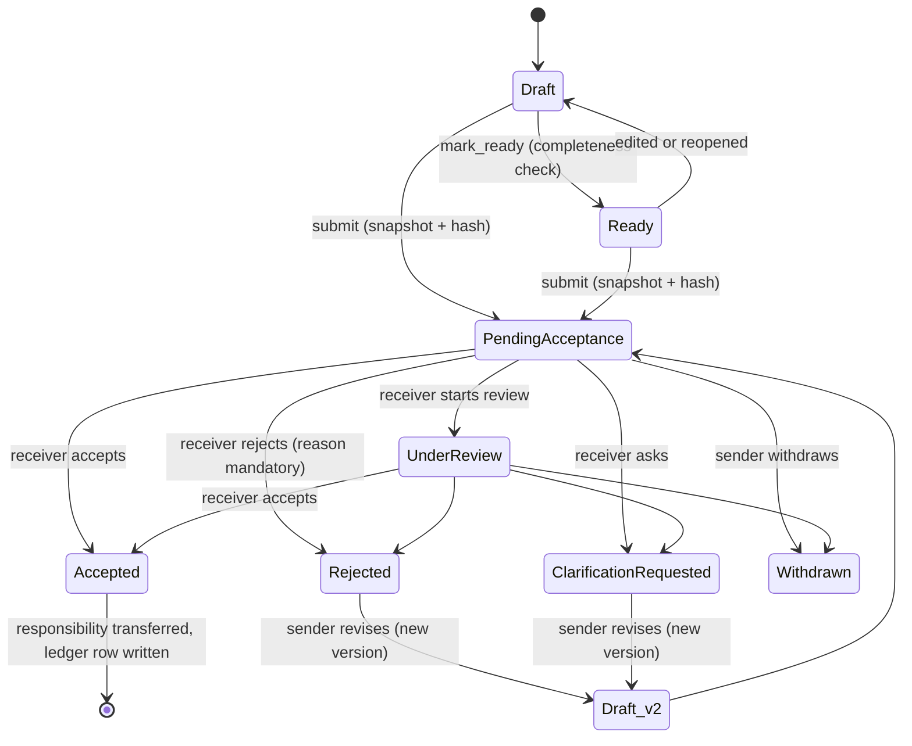

# NDS Enterprise Operations — Architecture

Status legend used across the docs: **PASS** (verified by a real test or a real browser run), **NOT IMPLEMENTED**,
**BLOCKED** (needs something outside this repository). Nothing here was run on a production or Saudi ERP site.

## 1. Baseline

| Item | Finding | Evidence |
| --- | --- | --- |
| Target platform | Frappe 16 / ERPNext 16 (Python 3.14, MariaDB) | built from `version-16` on an isolated bench |
| Saudi production site (`ndserpsa.nds-sa.com`, repo `moh222salah/ndserp-sa`) | **Not inspected, not touched.** Its installed apps, customisations and User Permission set are unknown to this work | BLOCKED until an audit is run there (read-only) |
| Egyptian ERP | Not touched | — |
| ERPNext `Employee` | Creates a **User Permission on Employee for every user** by default, which hides other employees from link fields and lists | observed; handled by `ignore_user_permissions` on the app's Link fields |
| HRMS | Not required. Only Employee, Department, Company, Project, Task, ToDo, File, Notification Log, Role are used | — |

## 2. Reuse matrix

| ERPNext / Frappe | Used for | Duplicated? |
| --- | --- | --- |
| Employee | people, user link, department, designation | no |
| Department (tree) | org structure; `NDS Department Profile` only adds manager / deputy | no |
| Company | via Employee / Department | no |
| Task | the unit of work; ownership mirrored in its **ToDo** assignments; department updated on cross-department acceptance | no (no custom fields added) |
| Project | linked from the handover | no |
| ToDo + `assign_to` | who currently holds a task | no |
| File | attachments; private files follow the handover's permissions | no |
| Notification Log | in-app alerts with a deep link | no |
| Role | 10 new roles; `Employee`, `System Manager` reused | no |

New DocTypes: `NDS Task Handover` (submittable), `NDS Handover Attachment` (child), `NDS Handover Review`,
`NDS Handover History`, `NDS Ownership History`, `NDS Team`, `NDS Team Membership`, `NDS Department Profile`,
`NDS Operations Settings` (single), `NDS Rejection Reason`.

## 3. Module architecture

```
Desk UI (JS/CSS)  ──►  api/handover.py (whitelisted, thin)  ──►  services/handover.py (the engine)
                                                                     ├─ services/ownership.py  (ledger, current owner)
                                                                     ├─ services/snapshot.py   (frozen JSON + SHA-256)
                                                                     ├─ services/history.py    (append-only timeline)
                                                                     └─ services/notifications.py
DocType controllers (validation, identity forcing)  ·  permissions.py (row scope, deny-only hooks)
```

Design rules that carry the safety of the module:

* **A submitted handover is immutable** — no field is `allow_on_submit`; the controller blocks update, cancel and delete.
* **Engine-only state.** `handover_status`, ownership and decision fields are written by the engine; a draft saved from
  the form or REST keeps the database values for them (a forged `handover_status` is ignored — tested).
* **The sender is the session user.** Sender fields are rebuilt from Employee on every draft save.
* **Responsibility moves only on acceptance**, in the same transaction as the decision, after re-validating that the task's
  ownership did not change since submission.
* **Lock order is always handover row → Task row.** A unique `(task, sequence)` key on the ledger is the last line of defence.
* **Idempotent.** Retried requests carry a `request_id` and replay the first result instead of repeating it.

## 4. DocTypes and relationships



## 5. Handover workflow

Execution status (the ERPNext Task) and handover status are separate fields. Draft and Ready are `docstatus 0`;
everything after submission is `docstatus 1` and engine-managed.



## 6. Permission matrix (enforced in the backend)

| Actor | Create / edit draft | Submit | Accept / Reject / Clarify | Withdraw / Revise | Read |
| --- | --- | --- | --- | --- | --- |
| Sender (must own the task, or manage its department) | own drafts | own drafts | — | own handovers | own, drafts included |
| Receiver (named on the handover) | — | — | **only the named receiver** | — | submitted handovers addressed to them |
| Team Leader / Department Manager | — | — | — | — | submitted handovers of their teams / departments |
| Executive Management, Read Only Auditor | — | — | — | — | every submitted handover |
| Operations Manager, System Manager | per DocPerm | per DocPerm | **not on behalf of others** | — | everything |
| Anyone, including Administrator | submitted records cannot be edited, cancelled or deleted; reviews, history and ledger rows are append-only | | | | |

Implementation: DocPerm roles + `permission_query_conditions` (list scoping) + `has_permission` (deny-only) in
`permissions.py` + controller/engine guards, because Administrator bypasses permission hooks.
Delegated acceptance and "approved exceptional self-acceptance" are **NOT IMPLEMENTED** (self-handover is always refused).

## 7. UI / UX screen map

| Screen | State |
| --- | --- |
| Handover Center (inbox, sent, needs my action, drafts, search, pagination, counts) | PASS (browser-verified) |
| Handover form workspace: stage bar, timeline, responsibility history, decisions, versions, integrity flag, action buttons and dialogs | PASS (browser-verified) |
| New Handover dialog | implemented; PASS in browser for Accept dialog only |
| Workspace + sidebar + desktop icon | implemented; sidebar entry order not yet verified |
| Operations Overview dashboard (permission-scoped handover KPIs, status distribution, receiving-department breakdown, recent activity) | PASS (5 tests; task KPIs; cards click through to filtered lists; browser-verified desktop + mobile; reviewed and corrected after a first draft whose API failed on Frappe v16) |
| Kanban/Gantt views | NOT IMPLEMENTED |
| RTL / mobile layout | CSS uses logical properties; not yet verified in a browser |

## 8. Risk assessment

| Risk | Mitigation / status |
| --- | --- |
| Unknown customisations on the Saudi site (User Permissions, Task client scripts, workflows on Task) | read-only audit **before** any install (BLOCKED) |
| Installing adds tables, roles, a workspace and a page | no Custom Fields and no core edits; uninstall removes them; full backup first (`docs/DEPLOYMENT.md`) |
| `ignore_user_permissions` on Employee/Department/Team links | deliberate: visibility is scoped by this app's own query conditions and tested |
| Manual ToDo re-assignment while a handover is pending | accept is refused if the ledger/ownership no longer matches; automatic ledger rows for manual reassignment **NOT IMPLEMENTED** |
| Notifications use Notification Log (+ the user's email settings) | no custom email; verified rows are created |
| Task.department changes on cross-department acceptance | by design, recorded in the ledger and as a Task comment |

## 9. Implementation plan and status

| Phase | Status |
| --- | --- |
| Org layer (Team, Membership, Department Profile, Settings, Rejection Reasons) | PASS (installed, validated) |
| Handover engine, API, snapshot, ledger, idempotency | PASS (24 tests) |
| Team Leader / Department Manager row scope, membership rules | PASS (3 tests) |
| Concurrency (3 real multi-connection races) | PASS |
| Desk UI (center, form, dialogs, CSS) | PASS (browser) |
| Handover Operations Overview / initial KPIs | PASS (5 tests: scope, decisions, overdue, access, task counts) |
| Reports: Task Handover Register, Acceptance (first-pass, hours), Rejection (reasons chart), Aging (buckets, receiver-only overdue) | PASS (5 tests; open in a browser; row-scoped; Excel/CSV/PDF via the standard report export) |
| Reports: Tasks Master, Overdue Tasks (visible reason only), Employee Workload | PASS (4 tests; open in a browser as Administrator; owner = ledger, else open ToDo, else creator) |
| KPI reports: Employee Productivity, Department Performance, Team Performance, Task Cycle Time, Rework and Revision (formulas printed on each; cancelled excluded; waiting-on-receiver delays excused; owner from ledger) | PASS (6 tests; 5 open in a browser, data-less ones show empty states) |
| Remaining reports: Project Delivery, Management Executive | NOT IMPLEMENTED |
| Task Update / Checklist / Review, Department KPI, Team Assignment | NOT IMPLEMENTED |
| Arabic translations (`translations/ar.csv`), local fonts | NOT IMPLEMENTED |
| Production audit and deployment | BLOCKED (needs explicit approval) |


## Arabic and RTL

`nds_operations/locale/ar.po` holds about 400 translated strings (labels, messages, report and dashboard text). Frappe v16 reads compiled `.mo` files, so run `bench compile-po-to-mo --app nds_operations --locale ar` (a normal `bench build`/update does it). Verified in a browser with an Arabic user: layout mirrors, no horizontal scroll on desktop or mobile. Not yet verified: the handover form and the reports in RTL.


## Delegation

`NDS Delegation` lets a receiver explicitly authorise another user to decide the handovers addressed to him, for a date range, revocable, never editable after creation and never deletable. The engine accepts a delegate's decision only inside the dates and never for the sender of that handover. The review stores `reviewer_user` (the delegate), `acted_on_behalf_of` and `delegation`; responsibility moves to the receiver the handover was addressed to, and the receiver is notified. Delegates see the delegator's handovers in the inbox and the row scope. Status: PASS (7 tests; form saved, shown Active and revoked in a browser).


## Reminders and notification preferences

Hourly `run_handover_reminders`: a receiver is reminded once when the response is due within `reminder_lead_hours` (default 4); both parties are alerted once when it is overdue; the receiver's department/team managers are told once after `escalate_overdue_after_hours` (default 24). Only handovers the receiver still owes (Pending, Under Review) are considered. Daily `run_task_reminders` reminds the current owner of open tasks that are due tomorrow or overdue. Each reminder leaves a history row (`Reminder Sent`, `Overdue Alert`, `Escalated`), which is also the guard against repeats. `NDS Notification Preference` lets a user mute reminders and progress updates; notices that carry responsibility (arrival, decisions, withdrawal, delegation, escalation) are always delivered. `enable_reminders` is read from the stored value, because a new Check field with a default loads as 0 on a site that existed before it: unset means on. Status: PASS (7 tests). Not verified: an actual scheduler tick on a running site (hooks are registered; jobs were exercised directly).

## Navigation (sidebar)

Frappe 16 no longer imports `<app>/workspace_sidebar/*.json`; a sidebar now ships per module as a `Sidebar` document under `<module>/sidebar/`. Without it the desk falls back to an auto-generated, alphabetical list. The curated sidebar (Overview, Handover Center, Task Handovers, Tasks, Projects, Organization, Audit Trail with Delegations, the 14 reports, Settings with Notification Preferences) is generated with `bench convert-sidebar-fixtures` and then extended; the old folder is kept so earlier v16 builds still read it. The workspace page also lists the reports, delegations and preferences. Verified in a browser on the sandbox (Frappe 16.55): the curated order loads. Not verified: how a Frappe build older than the one on the sandbox, including the production one, treats the two formats.


## Task updates

`NDS Task Update` is an append-only note on a Task (Progress, Issue, Help Request, Evidence, Note) with an optional progress percentage and evidence link or file. Only the current owner, as the ownership ledger defines it, can post; the author and timestamp come from the session, so they cannot be forged, and the Administrator is bound by the same controller guard. Ownership moves the right to post only on acceptance of a handover. Updates cannot be edited or deleted. Readers: the author, past and present owners, managers of the task's department, executives and auditors. A Progress update with a percentage sets the Task's progress. No further KPI document is pending.

The Task form has an NDS menu with Post Update (dialog) and View Updates, added with `doctype_js` rather than by editing ERPNext.

## Task checklist

`NDS Task Checklist` holds completion criteria for a Task. Only the current owner adds, ticks or removes items; `done_by` and `done_at` come from the session and are cleared on untick; a ticked item cannot be deleted. A `before_validate` hook on Task refuses `Completed` while a required item is open. It runs before ERPNext's own validation on purpose: ERPNext closes the task's assignments inside `validate`, which would otherwise change the owner even though the completion was refused. Tasks without a checklist behave exactly as before.

## Department KPI snapshots

`NDS Department KPI` freezes the Department Performance Report figures for a closed month: one row per department and period (unique key, idempotent), never rewritten or deleted. `services.kpi_snapshot.generate` refuses an unfinished period; `freeze_period` is limited to System Manager, Operations Manager and Executive Management; a daily job freezes last month during the first week of a month and catches up after a missed day. The generating user's visibility applies, so the scheduler (Administrator) produces company-wide rows. Open tasks are a count at generation time, not a period figure. Registered but not yet observed on a real scheduler tick.

## Organization chart

The page `nds-org-chart` draws departments (nested by parent), their active teams with leads, and active members. The department structure, manager names and member names come from `frappe.get_all` after a role check, because the Employee role only has "select" on Department and `get_list` then hides everything but the id; teams, memberships and open-task counts stay permission-scoped through `get_list`. Status: PASS with 3 tests and a browser run in RTL; the sandbox had departments but no teams, so the team and member cards were checked by the test only.

## Task review

`NDS Task Review` is the append-only quality review of a Completed task. The reviewer comes from the session and must hold Task Reviewer, Department Manager, Operations Manager or Executive Management; nobody who is, or ever was, an owner of the task in the ledger can review it; an approval needs a score from 1 to 5; the owner at review time is stamped so later reassignments cannot move the score onto someone else. A `Review Task` dialog on the Task form is added through `doctype_js`. The review score feeds the Employee Productivity Report (latest review per task, approvals only).

## Performance check

`tests/test_performance.py` seeds submitted handovers and compares the number of SQL queries per screen at 5 rows and at 5 + N rows (N defaults to 25; `NDS_PERF_ROWS=300` was used for the figures here), failing on growth, and fails any screen slower than 3 s. Result on the sandbox with 305 handovers: dashboard 15 → 12 queries, inbox 3 → 3, counts 6 → 6, org chart 35 → 6 (first call warms caches), register 1 → 1, workload 6 → 6, executive 6 → 6, all under 0.02 s. Limits: a local database, one user at a time, and the screens were run as Administrator; production hardware, real data volume and parallel users are not measured. The inbox and register are paginated, so their cost does not follow the row count by design.

## Employee and team profiles

The page `nds-profile` (routes `/desk/nds-profile`, `/employee/<id>`, `/team/<id>`) is fed by `nds_operations.api.profile`. An employee profile shows identity, teams, open and overdue tasks, completed tasks, on-time rate, average cycle time, handovers sent, handovers awaiting the person's decision, first-pass, rejection and rework rates, the handover quality score and the quality review score. A team profile shows members with a workload bar, team totals and the team's handover quality; a member is flagged as carrying a heavy load only with at least 3 open tasks and more than 1.5 times the team average.

Figures come from the same helpers as the reports (`services/kpi.py`, `reports.current_owners`), so the fairness rules are identical: owners from the ownership ledger, cancelled tasks out, a delay while a handover waits on its receiver is not counted as overdue, empty rates stay empty. Every query uses `get_list`, so a viewer only sees figures for records he may read. A profile of another employee needs read access to that Employee record or being that employee. Org-chart team and member names link to these pages. Status: PASS with 8 tests (figures, own profile, excused overdue, employee without user, refusals, heavy-load flag, balanced team, colleague access) and a browser run on the sandbox in desktop and mobile widths with no horizontal scroll. Not verified: large teams (member lists are not paged) and production data.
